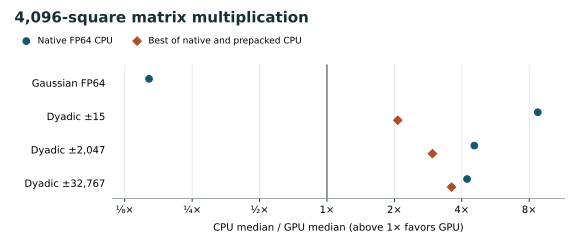

# Benchmarks on Apple M4 Max

On a 40-core M4 Max, release 0.3.0 multiplied two resident 4,096 × 4,096 FP64 matrices with scaled integer coefficients in ±15 in **20.647 ms**. The fastest measured native FP64 CPU took **180.50 ms**, an **8.74×** GPU advantage. With independent Gaussian FP64 values at the same size, the CPU took 203.10 ms and the GPU took 1,265.71 ms. Both timings include the wait for one completed result. The public 0.3.0.post1 distribution packages the measured 0.3.0 runtime. [Raw matrix measurements](results/v3-large-matrices.json)

[All CPU/GPU comparisons (CSV)](benchmarks/all-results.csv) · [GPU ahead of the fastest measured CPU (CSV)](benchmarks/gpu-ahead.csv) · [GPU ahead at matched allocation (CSV)](benchmarks/matched-allocation-ahead.csv) · [Sample times by path (CSV)](benchmarks/timed-paths.csv) · [Complete tables](benchmarks/tables.md)

## When dense matrix multiplication wins

For the dyadic inputs, one operand is an integer matrix scaled by 2⁻¹³ and the other is scaled by 2⁻⁹. The GPU checks every value on each call. When the products and partial sums meet the exactness bounds, it uses native matrix instructions and reconstructs the binary64 output. The main run timed preallocated GPU output against the fastest measured CPU implementation on the same inputs. A separate experiment gave a specialized CPU implementation prepacked digits, known scales and reusable scratch space for free.



| 4,096-square inputs | Native CPU ms | GPU ms | Native CPU/GPU | Best CPU/GPU in separate structure-aware run |
|---|---|---|---|---|
| Gaussian FP64 | 203.10 | 1,265.71 | 0.16× | — |
| Dyadic ±15 | 180.50 | 20.647 | 8.74× | 2.07× |
| Dyadic ±2,047 | 183.89 | 40.413 | 4.55× | 2.96× |
| Dyadic ±32,767 | 184.71 | 43.734 | 4.22× | 3.60× |

The two CPU baselines use independent interleaved runs with their own GPU times. The structure-aware result uses the faster of native CPU FP64 and prepacked Accelerate SGEMM with exact reconstruction. It favors the GPU in 8 of 9 cases. The 1,024-square ±15 case favors CPU. At 4,096 square and ±32,767, all 16,777,216 output words matched CPU FP64 bit for bit. Of those values, 16,715,921 lose information when converted to FP32. [Structure-aware timings](results/v3-matrix-optimized-cpu.json) · [CPU reference implementation](tools/matrix_cpu_reference.c) · [Exact GPU implementation](mps_fp64/exact_gemm.py)

## Placement and synchronization

An ordinary Gaussian 32,768 × 1,024 matrix with transposed storage multiplied by a 1,024 × 2 matrix reached **1.56×** with resident inputs. For 4,096 independent 4 × 4 matrix products, a single synchronized batch call took 0.1371 ms on GPU and 0.0414 ms on CPU. Submitting 12 batch calls before synchronizing changed the per-call times to 0.0345 and 0.0484 ms, respectively.

Uploading both inputs and returning the entire output on every call preserved a **2.71×** advantage for the 2,048-square ±2,047 case. The Gaussian 32,768 × 1,024 by 1,024 × 2 case fell to 0.34× with transfers. Each transfer-inclusive path allocates its output and finishes on the CPU. [Main-run samples](results/v3-large-matrices.json) · [Second input seed](results/v3-matrix-second-seed.json)

## Current release beyond matrices

The public tensor benchmark measured 24 completed CPU/GPU pairs with a wait after each call. The GPU finished sooner on **5** against the fastest measured native CPU path for each workload. Matching the output-allocation policy on both sides gives **10 of 24**. Letting the CPU reuse an output object whenever its API permits gives **5 of 24**. Both devices reused outputs where both APIs supported and passed the correctness check. The CSV also gives the ratio against matched CPU allocation and CPU output reuse. [Current raw measurements](results/public-tensor-ops.json) · [Runner](tools/benchmark_tensor_ops.py)

| Single-call workload | GPU ms | Matched CPU/GPU | Reusable CPU/GPU | Fastest CPU/GPU |
|---|---|---|---|---|
| `sort_rows_1m` | 0.7785 | 6.11× | 5.33× | 5.33× |
| `argmax_all_8m` | 1.046 | 3.67× | 3.71× | 3.67× |
| `topk_rows_1m` | 0.4750 | 1.85× | 1.90× | 1.85× |
| `relu_8m` | 0.7378 | 1.76× | 1.76× | 1.76× |
| `sum_columns_8m` | 0.7728 | 1.13× | 1.25× | 1.13× |
| `argmax_rows_8m` | 0.6042 | 1.05× | 0.97× | 0.97× |
| `var_rows_8m` | 7.217 | 1.12× | 0.92× | 0.92× |
| `abs_8m` | 0.5597 | 2.61× | 0.80× | 0.80× |
| `where_8m` | 1.161 | 1.32× | 0.68× | 0.68× |
| `neg_8m` | 0.6644 | 2.02× | 0.68× | 0.68× |

## Ordering across CPU thread counts

The ordering study tested stable row sort, global argmax and row-wise top-32 on three input sizes each. It ran GPU and CPU blocks separately, with CPU tested at 1, 4, 8, 12 and 16 threads. The GPU completed **6 of 9** cases sooner than the fastest tested CPU thread count and output policy for that case. At 4,096 × 2,048, global argmax took 0.3001 ms on GPU in the grouped run and 1.046 ms in the interleaved tensor suite. These are independent single-call measurements. [Per-shape analysis](benchmarks/ordering.md) · [Thread-sweep samples](results/public-ordering.json) · [Runner](tools/benchmark_ordering.py)

| Workload | Shape | Fastest CPU threads | CPU ms | GPU ms | CPU/GPU |
|---|---|---|---|---|---|
| `sort_128x128` | 128×128 | 12 | 0.2192 | 0.1623 | 1.35× |
| `argmax_128x128` | 128×128 | 4 | 0.0082 | 0.1692 | 0.05× |
| `topk_128x128` | 128×128 | 1 | 0.0433 | 0.1631 | 0.27× |
| `sort_2048x512` | 2048×512 | 12 | 3.959 | 0.3843 | 10.30× |
| `argmax_2048x512` | 2048×512 | 4 | 0.4691 | 0.2338 | 2.01× |
| `topk_2048x512` | 2048×512 | 12 | 0.7246 | 0.3922 | 1.85× |
| `sort_4096x2048` | 4096×2048 | 12 | 34.348 | 3.476 | 9.88× |
| `argmax_4096x2048` | 4096×2048 | 12 | 3.973 | 0.3001 | 13.24× |
| `topk_4096x2048` | 4096×2048 | 12 | 1.987 | 3.353 | 0.59× |

## Historical nonmatrix results in 0.2.0

The named workload suite measured 51 cases on release 0.2.0. Of 48 cases with CPU timings, the GPU finished sooner in **17**. All 17 GPU wins below used resident inputs and multiple calls per round. The CPU ran the same public FP64 operation with allocating outputs. FFT plan rebuilding and the two RNG comparisons have GPU-version timings only. [Historical named workload data](results/v2-workloads.json) · [Complete wins and losses](benchmarks/tables.md)

| Resident workload | Calls per round | CPU ms | GPU ms | CPU/GPU |
|---|---|---|---|---|
| `stable_sort_256x1024` | 4 | 1.635 | 0.1524 | 10.73× |
| `max_pool_8x32x56x56` | 12 | 0.5047 | 0.0918 | 5.50× |
| `mul_8388608` | 8 | 2.009 | 0.4684 | 4.29× |
| `div_8388608` | 8 | 1.916 | 0.4657 | 4.11× |
| `add_8388608` | 8 | 1.913 | 0.4677 | 4.09× |
| `tanh_1048576` | 10 | 0.7014 | 0.1774 | 3.95× |
| `add_262144` | 32 | 0.0916 | 0.0235 | 3.89× |
| `cos_1048576` | 10 | 0.4774 | 0.1469 | 3.25× |
| `cummax_8x32767` | 8 | 0.3534 | 0.1107 | 3.19× |
| `exp_1048576` | 10 | 0.3921 | 0.1394 | 2.81× |
| `aminmax_1024x4096_last` | 12 | 0.4808 | 0.1850 | 2.60× |
| `sin_1048576` | 10 | 0.4670 | 0.1866 | 2.50× |
| `log_1048576` | 10 | 0.5206 | 0.2094 | 2.49× |
| `max_1024x4096_last` | 12 | 0.2045 | 0.1029 | 1.99× |
| `avg_pool_8x32x56x56` | 12 | 0.1682 | 0.1203 | 1.40× |
| `argmax_262144` | 3 | 0.1250 | 0.1154 | 1.08× |
| `sum_1024x4096_first` | 12 | 0.2902 | 0.2798 | 1.04× |

## Coverage by experiment

A case is one measured workload within a row of this table. A second seed, a transfer, or a new submission pattern creates another comparison for the same operator. A GPU win requires its unrounded median to be strictly lower. Small differences can fall inside the run-to-run spread. Quartiles and the number of faster paired rounds are in the CSV. The initial and first-release stream archives omit the software version in their raw data.

| Experiment | Cases | GPU faster | CPU faster | Ties | Rounds | Calls per round |
|---|---|---|---|---|---|---|
| 0.3.0 matrix latency | 29 | 12 | 17 | 0 | 9 | 1 |
| 0.3.0 matrix round trip | 6 | 3 | 3 | 0 | 9 | 1 |
| 0.3.0 matrix queue throughput | 4 | 4 | 0 | 0 | 9 | 5–12 |
| 0.3.0 matrix latency, second seed | 6 | 4 | 2 | 0 | 5 | 1 |
| 0.3.0 matrix round trip, second seed | 1 | 0 | 1 | 0 | 5 | 1 |
| 0.3.0 matrix queue throughput, second seed | 1 | 1 | 0 | 0 | 5 | 5 |
| 0.3.0 structure-aware CPU comparison | 9 | 8 | 1 | 0 | 7 | 1 |
| 0.3.0 tensor latency | 24 | 5 | 19 | 0 | 11 | 1 |
| 0.3.0 ordering with tuned CPU threads | 9 | 6 | 3 | 0 | 9 | 1 |
| 0.2.0 named workloads, resident | 47 | 17 | 30 | 0 | 11 | 2–64 |
| 0.2.0 named workloads, round trip | 1 | 0 | 1 | 0 | 11 | 4 |
| 0.2.0 streaming and small GEMM | 3 | 1 | 2 | 0 | 7, 9 | 4–12 |
| Earlier public workload archive | 13 | 5 | 8 | 0 | 9 | 1–64 |
| First-release benchmark archive | 3 | 1 | 2 | 0 | 7, 9 | 4–12 |
| Initial benchmark archive | 3 | 1 | 2 | 0 | 7, 9 | 4–12 |

For 0.3.0 native matrix comparisons, CPU candidates include allocating and preallocated PyTorch plus direct Accelerate DGEMM, DGEMV or a preallocated outer product where applicable. The headline GPU path uses preallocated output for mm and bmm and the allocating public mv call. Each candidate was warmed and timed in shuffled order. GPU samples ended with a synchronization. The host-tensor and GPU-resident measurements exclude initial compilation. Source records identify the winning CPU path and the full set of candidates.

The OpInfo catalog compared the 0.1.0 and 0.2.0 GPU implementations. The CPU supplied correctness references only. Of 697 entries, 403 materialized samples had timings in both versions. Using the original thresholds of 10% and 2 µs, 355 were faster in 0.2.0 and 48 fell within the threshold. 4 samples received a separate 31-round, 48-call recheck. [All catalog entries and rechecks](benchmarks/opinfo-version-comparisons.csv) · [Catalog JSON](results/v2-catalog-timing.json) · [Recheck JSON](results/v2-paired-recheck.json)

## Reproduce and inspect

The recorded system used Apple M4 Max, macOS 15.7.1, PyTorch 2.11.0 and 12 configured CPU threads, with additional thread counts in the ordering study. Wall times include Python dispatch and output completion under the stated timing protocol. Each ratio uses medians from the same run. Quartiles use inclusive linear interpolation. They describe dispersion across timed rounds. The historical streaming harness and the CPU-thread study measured CPU and GPU paths in separate blocks. Their CSV rows leave paired-round wins blank.

Regenerate the tables and CSVs on any machine with Python 3.10 or later. The commands read the bundled measurements and check the published numbers, sample counts and quartiles. The optional `--figure` flag regenerates the SVG using Matplotlib 3.10.6.

```sh
python tools/publish_benchmarks.py
python tools/publish_benchmarks.py --check
```

To rerun the matrix measurements on a supported Mac, install the project with its `validation` extra as described in the README. Fetch the public baseline wheels with the helper below. The historical reports record the hashes of the original measurement artifacts. The fetch helper validates the public builds. Use a fresh output filename to keep the archived samples available for comparison. The specialized CPU runner compiles its Accelerate reference with xcrun clang. [Installation](README.md) · [Matrix runner](tools/benchmark_large_matrices.py) · [Structure-aware CPU runner](tools/benchmark_cpu_lattice.py)

```sh
export PYTORCH_ENABLE_MPS_FALLBACK=0
python tools/fetch_benchmark_baselines.py
python tools/benchmark_tensor_ops.py --output tensor-rerun.json
python tools/benchmark_ordering.py --output ordering-rerun.json
python tools/benchmark_large_matrices.py .benchmarks/mps_fp64-0.2.0-1public-py3-none-any.whl matrix-rerun.json --rounds 9
python tools/benchmark_cpu_lattice.py structure-rerun.json --rounds 7
```

To rerun the historical named workloads or OpInfo catalog, pass the 0.2.0 public candidate wheel and the 0.1.0 public baseline from the same checkout. The runner loads both isolated packages.

```sh
export PYTORCH_ENABLE_MPS_FALLBACK=0
python tools/compare_performance.py .benchmarks/mps_fp64-0.1.0-1public-py3-none-any.whl named-020-rerun.json --candidate-wheel .benchmarks/mps_fp64-0.2.0-1public-py3-none-any.whl --suite workloads --rounds 11
python tools/compare_performance.py .benchmarks/mps_fp64-0.1.0-1public-py3-none-any.whl opinfo-020-rerun.json --candidate-wheel .benchmarks/mps_fp64-0.2.0-1public-py3-none-any.whl --suite catalog --rounds 7 --batch 12
```

The all-results CSV keeps one row per GPU path and same-session CPU baseline. The first GPU-ahead file applies the fastest-CPU test. The matched-allocation file applies the `matched_cpu_over_gpu` test. Its `winner` column always describes the stricter fastest-CPU comparison. Both filters use full-precision medians. `role=primary` selects the paths in the complete tables. Source filenames resolve under `results/`. The per-path file retains alternative CPU implementations, native MPS FP32 comparisons when present, and the raw millisecond samples per call. Engineering comparisons of GPU kernels and arithmetic microbenchmarks have their own reports. [Result archive](results/) · [GPU arithmetic microbenchmark](results/gemm-arithmetic.json) · [Reduction timings](results/reduction-suite.json) · [Algorithm and validation notes](MATRIX_PERFORMANCE.md)
