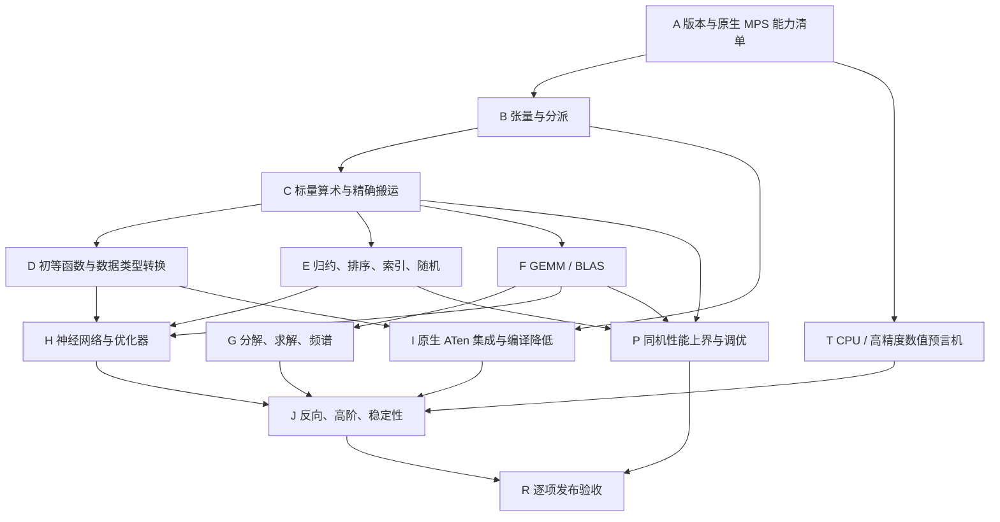

# PyTorch MPS 双精度后端任务图

首个验收平台固定为 40 核 M4 Max、macOS 15.7.1 和 PyTorch 2.11.0。当前交付为 eager 研究实现。公开 API 使用真正的 MPS 张量和 `torch.float64` 元数据，软件浮点内核解释 64 位存储。启用范围由 Python 线程内的上下文管理。发布级原生后端仍在任务图中。

## 验收对象

每条能力用版本、ATen overload、输入与输出 dtype、设备、形状、步幅、别名、梯度阶数和运行模式标识。以同机原生 MPS FP32 的可运行能力确定算子范围。纯整型操作沿用原生实现。FP64 的数值参考取 CPU binary64、独立高精度参考和数学残差。原生 MPS 自身的缺陷单独记录。显式 CPU 回退、隐式降到 FP32 和主机代算均不计 GPU 覆盖。

| 验收面 | 完成条件 | 当前证据及缺口 |
|---|---|---|
| 接口与行为 | 目标 API 支持工厂、拷贝、提升、广播、非连续视图、重叠检测、原地、out、合法和非法输入 | eager 子集已接入。应用须在作用域内使用 FP64 张量。缺少原生 ATen 分派、部分变体、序列化和编译接入 |
| 精度 | 基本算术测试用最近偶数舍入逐位比较，单独检查有符号零、次正规、溢出、无穷与 NaN 策略。超越函数逐函数定义 ULP 界。归约考虑树形求和顺序，分解与求解检查残差和后向误差 | 已有 TestFloat Level 1 六项、Level 2 五项和 MPFR 定点样本。NaN 载荷、异常标志、更多高精度困难点、病态矩阵族与不同运算顺序待验收 |
| 丰富度 | 固定版本全部原生可用操作逐 overload 有测试，所有目标正向、反向、高阶变体通过。补齐 OpInfo 之外的 MPS 专属测试 | 已有逐条双轨 OpInfo 抽查。短测每条最多三个样本；扩展审计遍历样本生成器，遇到首错停止。完整 API 与形状覆盖仍待验收 |
| 稳定性 | 非连续及重叠存储、空张量、异常恢复、跨线程、随机状态、长时训练、内存压力、多尺寸、多版本回归通过 | 已有线程并发、小图一阶与二阶检查、4096 轮循环、LU 错误处理。长时压力与多机验证待做 |
| 性能 | 每个重点工作负载建立传输或指令瓶颈模型；记录同机参考内核、吞吐曲线和端到端耗时，再约定目标比例 | 已有流式匹配访存内核、GEMM 分块扫描。流式目标可用有效 GB/s 衡量。GEMM、卷积、求解和超越函数还缺完整算力上界模型 |

## 依赖图

## 0.3.0 大矩阵进展

| 节点 | 本轮交付与验收 | 尚待解决 |
|---|---|---|
| B、F | `mm` 和 `bmm` 可复用预分配输出。针对窄输出、短内维、小矩阵批乘和一般稠密方阵提供专用内核 | 继续扩大布局、数据依赖与批次的性能覆盖 |
| C、F、T | 对满足数值界的二进制定点输入逐次全量验证，利用 GPU 矩阵指令计算并精确恢复 FP64。整矩阵逐位核对，新增算术路径以 Berkeley TestFloat 检查 | 一般满尾数方阵的有序软件 FMA 仍受每项尾数乘法、对齐和舍入成本限制 |
| P、J、R | 29 组驻留负载，另测传输、六组新种子和九组预打包专用 CPU 对照。安装包 88 项回归通过，固定 OpInfo 通过数保持 592/697 | 在其他芯片、长时稳定负载与整网中重复测量。普通 FP64 大方阵仍需缩小与原生 CPU 的差距 |

[大矩阵逐项耗时、数据范围与复现](MATRIX_PERFORMANCE.md)

## 0.2.0 已交付的路径

| 已实现的节点 | 可复核的产物 |
|---|---|
| B、C、D | 公共 ATen 快速分派，按步幅读取二进制标量、广播和非连续视图，11 个逐元素函数的定点近似与逐次舍入检查。[误差边界与复现](FAST_MATH.md) |
| E | SIMD 归约和排序，首次极值索引，保留索引顺序的散射归约，前缀极值与对数和，直方图和重复值压缩。[专项测量](results/reduction-suite.json) |
| F、G | GEMM 分块中复用已解码尾数。卷积、LU 与三角求解复用快速 FMA。FFT 缓存单位根，长非二次幂长度使用 Bluestein，极端指数保留直接求和路径。实数 SVD 与广义逆接受短边至 128、长边至 8192 的矩阵。[数值与梯度验证](results/jacobi-svd-20261118.json) |
| H、J | 加速归一化、门控、反传、池化、嵌入和插值。六种插值前反向与强缩放场景已测。[插值验证](results/resampling-20261118.json) |
| A、P、R | 强制工厂样本在 MPS 创建输出。同一场次比较历史 wheel、当前源码、CPU FP64 和原生 MPS FP32。目录清单同时保留通过样本数、首个错误、计时形状及不可同比条目。[本轮报告](PERFORMANCE.md) |

下表保留初版各节点及发布条件。0.2.0 的实测状态以本轮报告为准。

## 任务与交付顺序

| 节点 | 已实现 | 后续交付及阻断发布的问题 |
|---|---|---|
| A、T | 双轨 OpInfo 运行器、数值回归及原始结果 | 已固化源码 SHA 和直接 MPS 注册清单。继续枚举版本对应的 MPS 原生测试，扩充 TestFloat、MPFR 与系统级设备跟踪 |
| B、C | 真 MPS/FP64 张量、构造与传输、别名视图、整数 Metal 软件浮点、FMA | 补齐 dtype、mixed device、storage offset、原地/out、重叠、内存格式、异常与生命周期。构造、计算与拷回均需在作用域内 |
| D | OpenLibm 多项式与大参数三角约化移植到软件 binary64 | 全部特殊函数、组合域误差与导数。当前 ULP 样本上限仅适用于已测输入 |
| E | 并行树归约、稳定排序、部分索引与按位搬运、GPU 随机浮点生成 | 排序压力、重复索引写入、扫描、确定性选项、随机流与统计测试、超大张量分段 |
| F、G | 分块 GEMM、BMM、LU、Cholesky、三角求解、矩阵逆、有界实数 Jacobi SVD 与任意长度 FFT 常用路径 | QR、特征值、稀疏、大尺寸或更高动态范围的 SVD、超长 FFT 分块。扩充病态矩阵族及批处理压力验证 |
| H | ATen 分解、激活、Softmax、1D/2D/3D 卷积与转置卷积前反向 | 池化、全部归一化变体、注意力、优化器、网络训练轨迹与保存恢复 |
| I | 可安装的 Python eager 入口，复用 PyTorch 自动求导 | 在固定源码分支修改原生 MPS 分配器与按 dtype 路由，建立 C++/Metal 源码构建 CI；实现 AOTAutograd、Inductor lowering，移除对线程上下文的依赖 |
| J | 短时并发、逐位算术、部分布局与反向回归 | gradcheck / gradgradcheck 扩面、长循环内存曲线、取消与异常恢复、系统版本矩阵、无越界与竞态验证 |
| P | 同流量 XOR、公共 API 吞吐与分块扫描 | 分离提交/算术/带宽开销；硬件计数器、依赖链/独立指令吞吐、缓存冷热、卷积和求解专项、整网开销 |
| R | 有版本化工程、脚本和逐条结果 | 只有目标清单中所有缺项关闭且数值、语义、稳定性和性能分别达标才标记发布 |

每轮优先处理已经产生错误结果的路径，然后补操作缺口，最后在固定正确性基线上调整性能。扩大样本与平台覆盖时保留此前失败用例和原始计时，防止统计口径变化遮蔽回归。

## 下一阶段的依赖和验收

1. **原生存储与调度（B → I）**。在固定 PyTorch 源码版本接入 double 分配、密集和稀疏值存储、复制及 dtype 分派。验收从普通 Python 线程直接创建双精度 MPS 张量，再覆盖 ATen 调用和序列化往返。稀疏 COO 的构造、合并重复索引、转稠密及梯度是第一组端到端用例。
2. **补足逐项语义（A、T → J）**。将直接对比结果元素的目录与 SVD 重构和正交性、polygamma 高精度预言机、纯形状 API 的设备无关测试并列保存。按 overload、dtype、步幅及梯度阶数扩充目录外的原生 MPS 测试，持续保留现有 697 条的固定口径。
3. **计算密集路径与图模式（F、G、H、I → P）**。以矩阵乘、迭代分解、训练前反向和数据往返的实测差额安排调优。对比硬件计数、工作区流量和提交次数，量化原生分派与算子融合各自的收益。图模式用相同输入、梯度和存储语义验收。
4. **跨机发布验收（J、P → R）**。在更多 Apple 芯片和系统版本重复固定测试，增加长时间训练、重启恢复、并发和内存压力。每台机器独立建立匹配的带宽及算术参照，保存逐轮耗时和失败样本。
